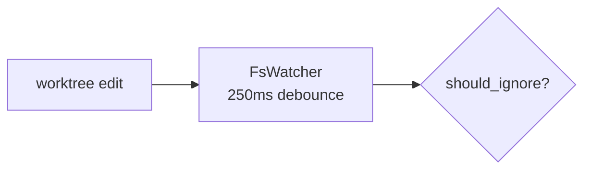

# Authoring mermaid diagrams

Oxplow renders ```mermaid fences in wiki pages and other markdown through
the in-app `MarkdownView` (mermaid v11). Nothing validates a diagram after
you write it, so an invalid one lands silently and only fails when the page
is opened, as `Mermaid parse error: TypeError: null is not an object
(evaluating 'element.firstChild')` — mermaid's downstream symptom, not a
real parser message. **Get it right at author time.**

## The one rule that prevents 90% of failures

**Quote every shape label.** Inside `[...]`, `{...}`, `(...)`, `[(...)]`,
`[[...]]`, wrap the body in double quotes:



NOT `A[worktree edit] --> B[FsWatcher<br/>250ms debounce]` and
`C{should_ignore?}`. Bare labels work sometimes; quoted labels always.
There is no downside to quoting, so quote unconditionally.

## Other rules in brief

- Node IDs are `[A-Za-z0-9_]` only; the quoted label is the displayed text.
- Edge labels (`A -->|yes| B`) take no quotes: plain words only.
- Quote multi-word `subgraph "Title"` names.
- Write a comparison as a word ("size over max") rather than `>` / `<`;
  `&gt;` inside a quoted label shows up literally. `<br>` is the line
  break.

`references/syntax.md` (get_skill reference `syntax`) has the characters
that break bare labels, the `>`/`<` trap, edge labels, sequence-diagram
messages, subgraph titles and node ids, with examples. Open it when a
diagram uses punctuation, a sequence diagram, or fails to render.

## When in doubt: quote it

Quote everything inside `[...]` / `{...}` / `(...)` and avoid literal `>` /
`<` in the body. That alone eliminates the `firstChild` failure mode.
